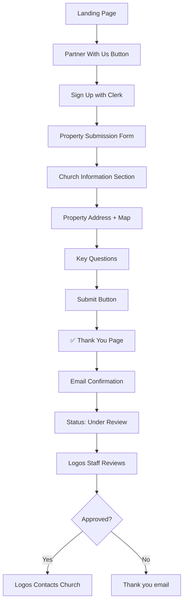
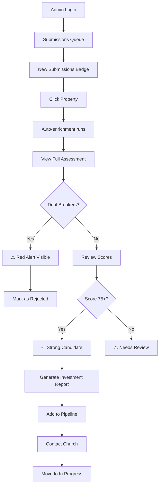
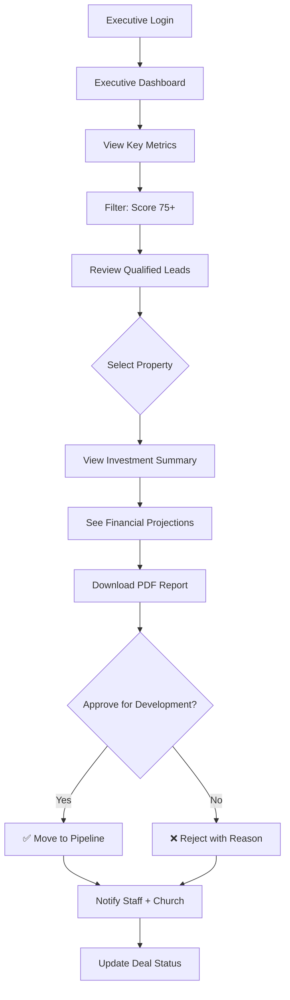

# 🎨 Frontend Development Plan - Property Intelligence Platform

**Created:** January 2025  
**Status:** Ready for Development  
**Stack:** Next.js 14 + TypeScript + Tailwind CSS + Clerk Auth

---

## 📋 Table of Contents

1. [Tech Stack](#tech-stack)
2. [User Personas](#user-personas)
3. [Page Structure](#page-structure)
4. [User Journey Flows](#user-journey-flows)
5. [Component Architecture](#component-architecture)
6. [Implementation Roadmap](#implementation-roadmap)
7. [Design System](#design-system)
8. [API Integration](#api-integration)

---

## 🛠️ Tech Stack

### **Core Framework**

- **Next.js 14** (App Router) - React framework with SSR/SSG
- **TypeScript** - Type safety
- **Tailwind CSS** - Utility-first styling
- **shadcn/ui** - High-quality component library

### **Authentication**

- **Clerk** - Already integrated in backend
- User management, SSO, roles

### **State Management**

- **React Query (TanStack Query)** - Server state management
- **Zustand** - Client state (if needed)
- **React Hook Form** - Form handling

### **Data Visualization**

- **Recharts** - Charts and graphs
- **Mapbox GL** - Interactive maps
- **React PDF** - PDF viewing

### **UI/UX**

- **Framer Motion** - Animations
- **Lucide Icons** - Icon system
- **Sonner** - Toast notifications

---

## 👥 User Personas

### **Primary Users**

#### 1. **Church Administrator** (External Partner)

- **Goals:** Partner with Logos to develop extra land into affordable housing
- **Business Model:** Church provides land, Logos funds 100% of development, shared ownership
- **Pain Points:** Unsure if their property qualifies, complex forms
- **Needs:** Simple submission form, quick response, clear next steps
- **Access Level:** Submit ONE property, view basic status only

#### 2. **Logos Staff (Property Analyst)** (Internal Team)

- **Goals:** Quickly evaluate if church property is a good investment
- **Pain Points:** Manual data gathering, need fast decisions for lined-up churches
- **Needs:** Automated scoring, deal-breaker alerts, investment recommendations
- **Access Level:** View all submissions, full assessment data, enrichment controls

#### 3. **Logos Executive/Decision Maker** (Internal Leadership)

- **Goals:** Approve high-potential properties, track pipeline, see ROI projections
- **Pain Points:** Too many submissions, need clear investment criteria
- **Needs:** Dashboard with qualified leads, deal pipeline, batch approvals
- **Access Level:** Full admin access, approve/reject decisions, financial reports

---

## 📄 Page Structure

### **Public Pages** (No Auth Required)

```
/                           → Landing Page (Marketing to churches)
/partner-with-us            → Benefits of partnership (Logos builds, church shares)
/how-it-works               → Partnership model explanation
/success-stories            → Case studies
/faq                        → Common questions
/login                      → Clerk-powered sign-in
/signup                     → Church registration
```

### **Church Portal** (Church User Auth - LIMITED ACCESS)

```
/submit-property            → ONE-TIME property submission form
/submission-status          → Simple status ("Received", "Under Review", "Contacted")
/profile                    → Church profile (view only after submission)
```

### **Logos Admin Portal** (Internal Staff - FULL ACCESS)

```
/admin/dashboard            → Submissions queue, metrics, deal pipeline
/admin/submissions          → All property submissions
  /admin/submissions/new   → New submissions queue (needs review)
  /admin/submissions/[id]  → Full assessment details + scores

/admin/properties           → All properties (enriched data view)
  /admin/properties/[id]   → Property detail with enrichment data
  /admin/properties/[id]/enrich → Manual re-enrichment trigger

/admin/churches             → Church management
  /admin/churches/[id]     → Church detail page
  /admin/churches/[id]/edit → Edit church info

/admin/assessments          → Assessment results
  /admin/assessments/[id]  → Full assessment scores & recommendation
  /admin/assessments/[id]/report → PDF report viewer

/admin/pipeline             → Deal pipeline (New → Review → Approved → In Progress)
/admin/reports              → All generated investment reports
/admin/analytics            → Platform-wide analytics (approval rate, avg scores)
/admin/users                → User management (staff + churches)
```

---

## 🚀 User Journey Flows

### **Flow 1: Church Partnership Submission (SIMPLE - Church View)**



**Key Screens for Churches:**

1. **Landing Page** - "We fund 100% of development, you share ownership"
2. **Partnership Benefits** - Explain business model
3. **Sign Up** - Clerk authentication
4. **Property Submission Form** - ONE comprehensive form with:
   - Church info (name, denomination, congregation size)
   - Property address with map picker
   - Ownership details (own free & clear? willing to ground lease?)
   - Congregation approval (voted? percentage?)
   - Parking needs after development
   - Special requirements
5. **Thank You Page** - "We'll review and contact you within 5 business days"
6. **Status Check** - Simple page showing "Received" or "Under Review"

**Churches DO NOT see:**

- ❌ Assessment scores
- ❌ Deal breakers
- ❌ Investment analysis
- ❌ Detailed reports
- ❌ Enrichment progress

---

### **Flow 2: Logos Staff - Investment Evaluation Workflow (FULL ACCESS)**



**Key Features for Logos Staff:**

- **Submissions Queue** - See new churches waiting for review
- **Auto-Enrichment** - Runs automatically when property submitted
- **Deal Breaker Alerts** - Visual warnings (red badges):
  - ❌ Lot too small (<10,000 sqft)
  - ❌ Can't build 40+ units
  - ❌ Cost per unit >$325k
  - ❌ High flood risk
  - ❌ Church doesn't own property free & clear
- **Score Dashboard** - See 5 category scores + overall grade
- **Investment Calculator** - Projected ROI, revenue sharing
- **Bulk Actions** - Approve/reject multiple submissions
- **Pipeline Management** - Move deals through stages
- **Report Generation** - PDF investment memos
- **Audit Trail** - Track who reviewed what

---

### **Flow 3: Logos Executive - Approve Investment Opportunities (HIGH-LEVEL)**



**Key Metrics for Executives:**

- **This Month:**
  - New church submissions: 45
  - Qualified leads (75+ score): 12
  - Approved for development: 4
  - Deal breaker rate: 38%
- **Pipeline Value:**
  - Total potential units: 1,200
  - Estimated project value: $48M
  - Average ROI: 18%
- **Geographic Distribution:**
  - Los Angeles: 60%
  - San Diego: 25%
  - Other CA: 15%
- **Top Properties This Week:**
  - Grace Community - 90 units - Score 87
  - First Baptist - 65 units - Score 82
  - Hope Church - 48 units - Score 78

---

## 📝 Church Submission Form Fields (CRITICAL)

### **Form Structure**

The property submission form is the **most important page** for churches. It should be comprehensive but user-friendly.

#### **Section 1: Church Information**

```typescript
// Church details
church_name: string (required)
legal_name: string (optional)
denomination: string (dropdown: Baptist, Methodist, Non-denominational, etc.)
founded_year: number (optional)

// Entity & Tax Information
entity_type: string (required - dropdown)
  - Options:
    - "501(c)(3) Nonprofit"
    - "Religious Corporation"
    - "Church/Religious Organization"
    - "Unincorporated Association"
    - "Other"
ein_number: string (optional)
  - Format: XX-XXXXXXX (masked input)
  - Tooltip: "Employer Identification Number for tax purposes"
website: string (optional)
  - Format: URL validation (https://example.com)
  - Placeholder: "https://yourchurch.org"

// Contact Information
street_address: string (required)
city: string (required)
state: string (required)
zip_code: string (required)
congregation_size: number (required - dropdown: <100, 100-300, 300-500, 500+)
annual_budget: number (optional)
primary_contact_name: string (required)
primary_contact_email: string (required)
primary_contact_phone: string (required)
```

#### **Section 2: Property Details**

```typescript
// Property location
property_address: string (required - Google Places autocomplete)
city: string (auto-filled)
state: string (auto-filled)
zip_code: string (auto-filled)
latitude: number (auto-filled from map picker)
longitude: number (auto-filled from map picker)

// Property characteristics
lot_size_sqft: number (optional - if church knows it)
lot_size_acres: number (calculated)
current_usage: string (dropdown: Vacant land, Parking lot, Old building, etc.)
zoning_description: string (optional - if church knows it)

// 🔥 Available Build Space (MANUAL OVERRIDE)
available_build_sqft: number (optional)
  - Label: "Available Build Space (if different from total lot size)"
  - Tooltip: "If only part of your property can be developed (e.g., existing building, parking, memorial garden), enter the buildable area in square feet"
  - Example: "Total lot: 50,000 sqft, but 20,000 sqft has existing church building, so available build space = 30,000 sqft"
  - Placeholder: "Leave blank if entire lot is available for development"
  - Help Text: "This helps us calculate accurate unit capacity. If left blank, we'll use the total lot size."
build_area_notes: string (optional - text area)
  - Label: "Build Area Notes"
  - Placeholder: "Describe any constraints (e.g., 'Southeast corner available', 'Preserve existing memorial garden')"
```

#### **Section 3: Ownership & Financial 🔥 CRITICAL**

```typescript
// Ownership status
owns_property_free_clear: boolean (required)
  - Yes → Continue
  - No → Show warning: "Property must be owned free & clear for partnership"

willing_to_ground_lease: boolean (required)
  - Explanation: "Would your church be willing to ground lease the land to Logos?"
  - Yes/No

has_mortgage: boolean (calculated from owns_free_clear)
mortgage_balance: number (if has_mortgage = true)
assessed_value: number (optional)
```

#### **Section 4: Congregation Approval 🔥 CRITICAL**

```typescript
// Voting & approval
congregation_voted: boolean (required)
  - "Has your congregation voted on this partnership?"
  - Yes/No

vote_percentage: number (if congregation_voted = true)
  - "What percentage approved?" (0-100)
  - Show validation: Must be >50% to proceed

leadership_support: string (required)
  - Dropdown: "Unanimous", "Strong Majority", "Majority", "Mixed"

denomination_approval_needed: boolean (required)
  - "Does your denomination require approval for this type of partnership?"
  - Yes/No
  - If Yes: Show info: "We'll work with you to navigate this process"
```

#### **Section 5: Parking & Development 🔥 CRITICAL**

```typescript
// Parking requirements
current_parking_spaces: number (optional)
parking_spaces_needed_after: number (required)
  - "How many parking spaces does your church need after development?"
  - Explanation: "We'll design the project to preserve spaces for your congregation"

special_requirements: text (optional)
  - "Any special requirements or considerations?"
  - Examples:
    - "Need community room for church programs"
    - "Some units for seniors in congregation"
    - "Preserve existing memorial garden"
```

#### **Section 6: Timeline & Preferences**

```typescript
// Development preferences
timeline_preference: string (dropdown)
  - "6-12 months"
  - "12-18 months"
  - "18-24 months"
  - "Flexible"

preferred_unit_count: number (optional)
  - "Do you have a preferred number of units?" (20-140)

affordability_target: string (dropdown)
  - "30% AMI" (Extremely Low Income)
  - "50% AMI" (Very Low Income)
  - "60% AMI" (Low Income)
  - "80% AMI" (Moderate Income)
  - "Mix of income levels" (default)

revenue_sharing_preference: string (dropdown)
  - "50/50 split"
  - "Flexible - open to discussion"
  - "Church receives fixed annual payment"
  - "Church receives % of net income"

development_involvement_level: string (dropdown)
  - "Passive partner (Logos handles everything)"
  - "Active partner (church involved in decisions)"
  - "Community oversight (church reviews progress)"
```

### **Form Validation Rules**

```typescript
// Required fields
- Church name, address, contact info
- Entity type (dropdown selection)
- Property address with confirmed location on map
- owns_property_free_clear must be true (deal breaker if false)
- congregation_voted (if true, vote_percentage must be >50%)
- parking_spaces_needed_after

// Optional fields (with validation if provided)
- EIN number: Must match format XX-XXXXXXX (9 digits total)
- Website: Must be valid URL format (https://...)
- Available build space: Must be positive number, <= lot_size_sqft
- Build area notes: Max 500 characters

// Warnings (not blockers)
- If lot_size_sqft < 10,000 → Show warning: "Small lots may not qualify"
- If available_build_sqft < 10,000 → Show warning: "Limited build space may not qualify"
- If vote_percentage < 66% → Show warning: "Logos prefers strong congregation support"
- If denomination_approval_needed = true → Show info about approval process

// Auto-calculations
- lot_size_acres = lot_size_sqft / 43,560
- If congregation_voted = false → leadership_support must be provided
- If available_build_sqft is provided:
  - Validate: available_build_sqft <= lot_size_sqft
  - Use available_build_sqft for unit capacity calculations
  - Show info: "Using {available_build_sqft} sqft for buildable area instead of total lot size"
```

### **Form UX Best Practices**

1. **Progress Indicator** - Show 6 steps at top
2. **Save Draft** - Allow churches to save and come back later
3. **Help Text** - Explain complex fields with tooltips
4. **Map Picker** - Visual confirmation of property location
5. **Mobile-Friendly** - Large touch targets, clear labels
6. **Validation** - Real-time validation with helpful error messages
7. **Confirmation** - Show summary before final submit

---

## 🏗️ Component Architecture

### **Layout Components**

```typescript
components / layout / PublicLayout.tsx; // For landing page, marketing
ChurchPortalLayout.tsx; // Simple layout for church users
AdminLayout.tsx; // Full sidebar for Logos staff
Sidebar.tsx; // Admin navigation
Header.tsx; // Top bar with user menu + role indicator
Footer.tsx; // Footer
Breadcrumbs.tsx; // Navigation breadcrumbs
```

### **Church-Facing Components (SIMPLE)**

```typescript
components / church / SubmissionForm.tsx; // 🔥 Main property submission form
ChurchInfoSection.tsx; // Church details (name, denomination, size)
PropertyAddressSection.tsx; // Address with map picker
OwnershipSection.tsx; // Free & clear? Ground lease willing?
CongregationSection.tsx; // Voted? Percentage? Approval needed?
ParkingSection.tsx; // Spaces needed after development
SubmissionSuccess.tsx; // Thank you page
StatusChecker.tsx; // Simple status display
```

### **Admin Components (FULL FEATURES)**

```typescript
components / admin / dashboard / SubmissionQueue.tsx; // New submissions with badges
MetricsCards.tsx; // Monthly stats
PipelineOverview.tsx; // Deal stages visualization
RecentActivity.tsx; // Audit log feed

properties / PropertyCard.tsx; // Preview card with score badge
PropertyDetail.tsx; // Full enrichment data display
PropertyMap.tsx; // Mapbox with property marker
EnrichmentStatus.tsx; // API data fetch status
DealBreakerAlert.tsx; // ⚠️ Red warning component

assessments / ScoreBreakdown.tsx; // 5 category scores + overall
GradeIndicator.tsx; // A+, B, C, D, F grade
RecommendationCard.tsx; // Approve/Reject recommendation
FinancialSummary.tsx; // Unit capacity, cost, ROI
DealBreakerList.tsx; // List of disqualifiers

churches / ChurchCard.tsx; // Church preview
ChurchDetail.tsx; // Full church profile
ChurchForm.tsx; // Edit church (admin only)

reports / PDFViewer.tsx; // Embed investment report
ReportGenerator.tsx; // Generate new reports
InvestmentMemo.tsx; // Executive summary format

pipeline / PipelineBoard.tsx; // Kanban-style deal stages
DealCard.tsx; // Property in pipeline
BulkActions.tsx; // Approve/reject multiple
```

### **Shared Components**

```typescript
components / shared / DataTable.tsx; // Reusable table with sorting
StatusBadge.tsx; // Status chips (New, Reviewing, Approved)
ScoreBadge.tsx; // Color-coded score indicator
LoadingSpinner.tsx; // Loading states
EmptyState.tsx; // No data placeholders
ConfirmDialog.tsx; // Confirmation modals
ErrorAlert.tsx; // Error messages
SuccessToast.tsx; // Success notifications
AddressAutocomplete.tsx; // Google Places autocomplete
```

### **Page Templates**

```typescript
app/
  // PUBLIC PAGES (Marketing to churches)
  (public)/
    page.tsx                      // Landing page
    partner-with-us/page.tsx      // Partnership benefits
    how-it-works/page.tsx         // Process explanation
    success-stories/page.tsx      // Case studies
    faq/page.tsx                  // Common questions

  // CHURCH PORTAL (Limited Access)
  (church)/
    layout.tsx                    // Simple church layout
    submit-property/page.tsx      // 🔥 Main submission form
    submission-status/page.tsx    // Check status
    profile/page.tsx              // View church info (read-only)

  // ADMIN PORTAL (Logos Staff - Full Access)
  admin/
    layout.tsx                    // Admin layout with full sidebar
    dashboard/page.tsx            // Submissions queue + metrics

    submissions/
      page.tsx                    // All submissions list
      new/page.tsx                // New submissions queue
      [id]/page.tsx               // Full assessment view

    properties/
      page.tsx                    // All properties
      [id]/page.tsx               // Property detail + enrichment
      [id]/enrich/page.tsx        // Manual enrichment trigger

    churches/
      page.tsx                    // Church management
      [id]/page.tsx               // Church detail
      [id]/edit/page.tsx          // Edit church (admin)

    assessments/
      page.tsx                    // All assessments
      [id]/page.tsx               // Assessment scores
      [id]/report/page.tsx        // PDF report viewer

    pipeline/
      page.tsx                    // Deal pipeline (Kanban board)

    reports/
      page.tsx                    // Generated reports

    analytics/
      page.tsx                    // Platform analytics

    users/
      page.tsx                    // User management
```

---

## 📐 Implementation Roadmap (REVISED - Budget-Conscious)

### **🚀 PHASE 1: Church Submission Form (Week 1-2) - HIGHEST PRIORITY**

**Goal:** Get churches submitting properties IMMEDIATELY

#### Week 1: Project Setup + Landing Page

- [ ] Initialize Next.js 14 project with TypeScript
- [ ] Setup Tailwind CSS + shadcn/ui
- [ ] Configure Clerk authentication
- [ ] Create landing page (marketing)
- [ ] Build "Partner With Us" page explaining business model
- [ ] Setup API client for backend connection

#### Week 2: Property Submission Form 🔥

- [ ] Build comprehensive submission form with sections:
  - [ ] Church information (name, denomination, congregation size)
  - [ ] Property address with Google Places autocomplete
  - [ ] Ownership details (own free & clear? willing to ground lease?)
  - [ ] Congregation approval (voted? percentage? denomination approval needed?)
  - [ ] Parking needs after development
  - [ ] Special requirements
- [ ] Integrate map picker (Mapbox) to confirm location
- [ ] Setup form validation (Zod)
- [ ] Create "Thank You" confirmation page
- [ ] Test end-to-end submission → backend → enrichment triggers

**Deliverable:** Churches can submit properties and data flows to backend ✅

**Success Criteria:**

- Church signs up → fills form → submits → gets confirmation email
- Backend receives submission → triggers auto-enrichment → creates assessment

---

### **📊 PHASE 2: Admin Dashboard (Week 3-4) - HIGH PRIORITY**

**Goal:** Logos staff can review submissions and make decisions

#### Week 3: Submissions Queue

- [ ] Build admin layout with sidebar
- [ ] Create submissions dashboard
- [ ] Show "New Submissions" queue with badge count
- [ ] Display submission cards with:
  - [ ] Church name
  - [ ] Property address
  - [ ] Submission date
  - [ ] Status (New, Reviewing, Approved, Rejected)
- [ ] Click submission → view full details

#### Week 4: Assessment Review Page

- [ ] Build assessment detail page showing:
  - [ ] Overall score + grade (A+, B, C, etc.)
  - [ ] 5 category scores (Location, Market, Financial, Partnership, Risk)
  - [ ] Deal breaker alerts (red warnings)
  - [ ] Financial metrics (unit capacity, cost per unit, ROI)
  - [ ] Church qualification details
- [ ] Add "Approve" / "Reject" buttons
- [ ] Show enrichment data (demographics, flood risk, HUD data)
- [ ] Display map with property location

**Deliverable:** Logos staff can review and approve/reject submissions ✅

**Success Criteria:**

- Admin logs in → sees new submissions → clicks property → sees full assessment
- Can approve high-scoring properties (75+) or reject deal breakers

---

### **📄 PHASE 3: Reports & Pipeline (Week 5-6) - MEDIUM PRIORITY**

**Goal:** Generate investment reports and track deal pipeline

#### Week 5: PDF Reports

- [ ] Build PDF viewer component
- [ ] Add "Generate Investment Report" button
- [ ] Display report in modal/new tab
- [ ] Add "Download PDF" button
- [ ] Add "Email to Executive" button

#### Week 6: Deal Pipeline

- [ ] Build pipeline/Kanban board with stages:
  - [ ] New Submissions
  - [ ] Under Review
  - [ ] Approved
  - [ ] In Progress (Development)
  - [ ] Completed
- [ ] Drag-and-drop to move deals between stages
- [ ] Add filters (score range, location, date)
- [ ] Show pipeline metrics (# deals per stage, total value)

**Deliverable:** Investment reports + pipeline tracking ✅

**Success Criteria:**

- Generate PDF report for approved properties
- Track deals from submission → approval → development

---

### **📈 PHASE 4: Analytics & Polish (Week 7-8) - NICE TO HAVE**

**Goal:** Executive dashboard and platform polish

#### Week 7: Executive Dashboard

- [ ] Build executive metrics page:
  - [ ] Monthly submission count
  - [ ] Qualified leads (75+ score)
  - [ ] Approval rate
  - [ ] Deal breaker rate
  - [ ] Geographic distribution (map)
  - [ ] Top properties this month
- [ ] Add trend charts (submissions over time)
- [ ] Show total pipeline value

#### Week 8: Polish & Testing

- [ ] Add loading states and animations
- [ ] Implement error boundaries
- [ ] Add toast notifications (success/error)
- [ ] Test all user flows end-to-end
- [ ] Mobile responsive fixes
- [ ] Performance optimization

**Deliverable:** Production-ready platform with analytics ✅

**Success Criteria:**

- Executives can see high-level metrics
- Platform is polished and bug-free
- Mobile-friendly

---

### **🎯 MVP FEATURES (Must-Have)**

✅ Church submission form (Week 1-2)
✅ Admin submissions queue (Week 3)
✅ Assessment review page (Week 4)
✅ PDF report generation (Week 5)
✅ Deal pipeline tracker (Week 6)

### **🚀 Phase 2 Features (Later)**

- Church status portal (simple status check)
- Bulk approve/reject actions
- Advanced analytics (ROI projections, heat maps)
- Email notifications automation
- Export to Excel for investment committee
- User management (staff permissions)

### **💡 Future Enhancements (Nice to Have)**

- AI chat for church questions
- Mobile app for field visits
- Automated email campaigns to churches
- Integration with CRM
- Property comparison tool
- Custom report templates

---

## 🎨 Design System

### **Color Palette**

```typescript
// Primary Brand Colors
const colors = {
  primary: {
    50: '#e6f2ff',
    100: '#b3d9ff',
    500: '#2c5aa0', // Main brand blue
    700: '#1e4176',
    900: '#0d1f3d',
  },

  success: {
    50: '#e8f5e9',
    500: '#4caf50',
    700: '#2e7d32',
  },

  warning: {
    50: '#fff9c4',
    500: '#fbc02d',
    700: '#f57f17',
  },

  error: {
    50: '#ffebee',
    500: '#f44336',
    700: '#c62828',
  },

  neutral: {
    50: '#f5f5f5',
    100: '#e0e0e0',
    300: '#9e9e9e',
    500: '#616161',
    700: '#424242',
    900: '#212121',
  },
};
```

### **Typography**

```typescript
// Font Stack
fonts: {
  sans: ['Inter', 'system-ui', 'sans-serif'],
  mono: ['Fira Code', 'monospace'],
}

// Font Sizes
fontSize: {
  xs: '0.75rem',    // 12px
  sm: '0.875rem',   // 14px
  base: '1rem',     // 16px
  lg: '1.125rem',   // 18px
  xl: '1.25rem',    // 20px
  '2xl': '1.5rem',  // 24px
  '3xl': '1.875rem', // 30px
  '4xl': '2.25rem',  // 36px
}
```

### **Component Variants**

```typescript
// Button Variants
<Button variant="primary">Analyze Property</Button>
<Button variant="secondary">Cancel</Button>
<Button variant="outline">View Details</Button>
<Button variant="ghost">More Options</Button>
<Button variant="destructive">Delete</Button>

// Badge Variants
<Badge variant="success">Approved</Badge>
<Badge variant="warning">Pending</Badge>
<Badge variant="error">Deal Breaker</Badge>
<Badge variant="neutral">Draft</Badge>

// Card Variants
<Card variant="elevated">...</Card>
<Card variant="outlined">...</Card>
<Card variant="flat">...</Card>
```

---

## 🔌 API Integration

### **API Client Setup**

```typescript
// lib/api-client.ts
import axios from 'axios';
import { useAuth } from '@clerk/nextjs';

const apiClient = axios.create({
  baseURL: process.env.NEXT_PUBLIC_API_URL,
  timeout: 30000,
});

// Add auth token to requests
apiClient.interceptors.request.use(async (config) => {
  const { getToken } = useAuth();
  const token = await getToken();

  if (token) {
    config.headers.Authorization = `Bearer ${token}`;
  }

  return config;
});

// Handle errors globally
apiClient.interceptors.response.use(
  (response) => response,
  (error) => {
    if (error.response?.status === 401) {
      // Redirect to login
      window.location.href = '/login';
    }
    return Promise.reject(error);
  }
);

export default apiClient;
```

### **React Query Setup**

```typescript
// hooks/useSubmissions.ts (For church submissions)
import { useQuery, useMutation, useQueryClient } from '@tanstack/react-query';
import apiClient from '@/lib/api-client';

// Submit property (Church user)
export const useSubmitProperty = () => {
  const queryClient = useQueryClient();

  return useMutation({
    mutationFn: async (submission: PropertySubmissionDto) => {
      // Creates church, property, and assessment in one go
      // Payload includes:
      // - Church info (name, entity_type, ein_number, website, etc.)
      // - Property info (address, lot_size, available_build_sqft, build_area_notes)
      // - Assessment preferences (parking, congregation approval, etc.)
      const { data } = await apiClient.post('/api/v1/submissions', submission);
      return data;
    },
    onSuccess: () => {
      // Triggers auto-enrichment on backend
      queryClient.invalidateQueries({ queryKey: ['submissions'] });
    },
  });
};

// Check submission status (Church user)
export const useSubmissionStatus = () => {
  return useQuery({
    queryKey: ['submission-status'],
    queryFn: async () => {
      const { data } = await apiClient.get('/api/v1/submissions/my-status');
      return data;
    },
  });
};

// Admin hooks
// Fetch all submissions (Admin only)
export const useSubmissions = (filters?: SubmissionFilters) => {
  return useQuery({
    queryKey: ['submissions', filters],
    queryFn: async () => {
      const { data } = await apiClient.get('/api/v1/admin/submissions', {
        params: filters,
      });
      return data;
    },
  });
};

// Fetch single submission with full assessment (Admin only)
export const useSubmission = (id: string) => {
  return useQuery({
    queryKey: ['submissions', id],
    queryFn: async () => {
      const { data } = await apiClient.get(`/api/v1/admin/submissions/${id}`);
      return data;
    },
    enabled: !!id,
  });
};

// Approve/Reject submission (Admin only)
export const useUpdateSubmissionStatus = () => {
  const queryClient = useQueryClient();

  return useMutation({
    mutationFn: async ({
      id,
      status,
      notes,
    }: {
      id: string;
      status: 'approved' | 'rejected';
      notes?: string;
    }) => {
      const { data } = await apiClient.put(
        `/api/v1/admin/submissions/${id}/status`,
        {
          status,
          notes,
        }
      );
      return data;
    },
    onSuccess: () => {
      queryClient.invalidateQueries({ queryKey: ['submissions'] });
    },
  });
};

// Generate investment report (Admin only)
export const useGenerateReport = () => {
  return useMutation({
    mutationFn: async (assessmentId: string) => {
      const { data } = await apiClient.get(
        `/api/v1/reports/assessment/${assessmentId}/pdf`,
        { responseType: 'blob' }
      );
      return data;
    },
  });
};
```

### **API Endpoints Reference**

```typescript
// CHURCH USER ENDPOINTS (Public/Limited)
POST   /api/v1/submissions            // Submit property for review (creates church + property + assessment)
GET    /api/v1/submissions/my-status  // Check submission status

// ADMIN ENDPOINTS (Internal Logos Staff Only)

// Submissions Queue
GET    /api/v1/admin/submissions           // List all submissions with filters
GET    /api/v1/admin/submissions/new       // New submissions queue
GET    /api/v1/admin/submissions/:id       // Get full submission details
PUT    /api/v1/admin/submissions/:id/status // Approve/reject submission

// Churches (Admin Management)
GET    /api/v1/churches                    // List all churches
POST   /api/v1/churches                    // Create church (admin)
GET    /api/v1/churches/:id                // Get church by ID
PUT    /api/v1/churches/:id                // Update church (admin)
DELETE /api/v1/churches/:id                // Delete church (admin)

// Properties (Admin View)
GET    /api/v1/properties                  // List all properties
GET    /api/v1/properties/:id              // Get property by ID
PUT    /api/v1/properties/:id              // Update property (admin)
POST   /api/v1/properties/:id/enrich       // Re-trigger enrichment (manual)
GET    /api/v1/properties/:id/enrichment-status // Check enrichment progress

// Assessments (Admin Review)
GET    /api/v1/assessments                 // List all assessments
GET    /api/v1/assessments/:id             // Get full assessment with scores
POST   /api/v1/assessments/:id/process     // Re-run AI assessment (if needed)

// Reports (Admin Only)
GET    /api/v1/reports/assessment/:id/pdf  // Generate investment PDF report
GET    /api/v1/reports                     // List all generated reports

// Analytics (Admin Dashboard)
GET    /api/v1/analytics/metrics           // Platform metrics
GET    /api/v1/analytics/pipeline          // Deal pipeline stats
GET    /api/v1/analytics/geographic        // Geographic distribution

// Users (Admin Management)
GET    /api/v1/users                       // List all users (staff + churches)
GET    /api/v1/users/:id                   // Get user details
PUT    /api/v1/users/:id/role              // Update user role/permissions
```

---

## 📱 Responsive Design

### **Breakpoints**

```typescript
// tailwind.config.js
screens: {
  'sm': '640px',   // Mobile landscape
  'md': '768px',   // Tablet
  'lg': '1024px',  // Desktop
  'xl': '1280px',  // Large desktop
  '2xl': '1536px', // Extra large
}
```

### **Mobile-First Approach**

```tsx
// Example: Responsive Property Card
<div className="grid grid-cols-1 md:grid-cols-2 lg:grid-cols-3 gap-4">
  {properties.map(property => (
    <PropertyCard key={property.id} property={property} />
  ))}
</div>

// Example: Responsive Sidebar
<aside className="
  fixed inset-y-0 left-0 z-50
  w-64
  transform transition-transform
  lg:translate-x-0 lg:static
  -translate-x-full // Hidden on mobile
">
  <Sidebar />
</aside>
```

---

## 🔒 Security Considerations

### **Client-Side Security**

1. **Environment Variables**

   - Use `.env.local` for sensitive keys
   - Never commit API keys to Git
   - Use `NEXT_PUBLIC_` prefix only for truly public vars

2. **API Security**

   - All requests include Clerk JWT token
   - Validate user permissions on backend
   - Sanitize user input

3. **Data Validation**
   - Use Zod schemas for form validation
   - Validate on both client and server
   - Display clear error messages

### **Example: Protected Route**

```tsx
// middleware.ts
import { authMiddleware } from '@clerk/nextjs';

export default authMiddleware({
  publicRoutes: ['/', '/about', '/how-it-works', '/pricing'],
  ignoredRoutes: ['/api/webhook'],
});

export const config = {
  matcher: ['/((?!.+\\.[\\w]+$|_next).*)', '/', '/(api|trpc)(.*)'],
};
```

---

## 📊 Key Features Summary

### **🚀 MVP Features (Weeks 1-6) - MUST HAVE**

**Church-Facing:**

- ✅ Landing page (marketing Logos partnership model)
- ✅ User authentication (Clerk)
- ✅ Comprehensive property submission form with:
  - Church information
  - Property address + map picker
  - Ownership details (free & clear? ground lease?)
  - Congregation approval (voted? percentage?)
  - Parking needs after development
  - Special requirements
- ✅ Submission confirmation page
- ✅ Basic status check page

**Admin-Facing:**

- ✅ Admin authentication with role detection
- ✅ Submissions queue dashboard (new submissions badge)
- ✅ Full assessment review page with:
  - Overall score + grade (A-F)
  - 5 category scores breakdown
  - Deal breaker alerts (red warnings)
  - Financial metrics (unit capacity, cost per unit, ROI)
  - Church qualification details
  - Enrichment data display
- ✅ Approve/reject workflow
- ✅ PDF investment report generation
- ✅ Deal pipeline tracker (Kanban board)

### **📈 Phase 2 Features (Weeks 7-8) - NICE TO HAVE**

- 📊 Executive dashboard with metrics:
  - Monthly submission count
  - Qualified leads (75+ score)
  - Approval rate / deal breaker rate
  - Geographic distribution
  - Top properties
- 📧 Email notifications (approval/rejection)
- 🎯 Bulk approve/reject actions
- 📱 Mobile responsive optimization
- 📈 Trend charts (submissions over time)
- 📤 Export to Excel for investment committee

### **🔮 Future Enhancements (Later)**

- 🤖 AI chatbot for church questions
- 🗺️ Interactive map with all submissions
- 📤 Property comparison tool
- 🔄 Automated email campaigns to churches
- 📊 Custom report templates
- 👥 Team collaboration (assign reviewers)
- 📲 Mobile app for field visits
- 🔗 CRM integration (Salesforce, HubSpot)
- 📸 Property photo uploads
- 📝 Internal notes and comments

---

## 🚀 Getting Started Checklist

### **Before You Start**

- [ ] Review backend API documentation
- [ ] Setup development environment
- [ ] Install Node.js 18+
- [ ] Setup Git repository
- [ ] Get Clerk API keys
- [ ] Get Mapbox API key
- [ ] Review design mockups

### **Development Setup**

```bash
# Create Next.js project
npx create-next-app@latest property-intelligence-frontend --typescript --tailwind --app

# Install dependencies
cd property-intelligence-frontend
npm install @clerk/nextjs @tanstack/react-query axios
npm install recharts mapbox-gl date-fns
npm install -D @types/mapbox-gl

# Setup shadcn/ui
npx shadcn-ui@latest init

# Add components
npx shadcn-ui@latest add button
npx shadcn-ui@latest add card
npx shadcn-ui@latest add form
npx shadcn-ui@latest add table
npx shadcn-ui@latest add dialog
npx shadcn-ui@latest add badge
npx shadcn-ui@latest add select
npx shadcn-ui@latest add input

# Start development server
npm run dev
```

### **Environment Variables**

```env
# .env.local
NEXT_PUBLIC_API_URL=http://localhost:8000
NEXT_PUBLIC_CLERK_PUBLISHABLE_KEY=pk_test_...
CLERK_SECRET_KEY=sk_test_...
NEXT_PUBLIC_MAPBOX_TOKEN=pk.eyJ1...
```

---

## 📚 Additional Resources

### **Documentation**

- [Next.js 14 Docs](https://nextjs.org/docs)
- [Clerk Authentication](https://clerk.com/docs)
- [shadcn/ui Components](https://ui.shadcn.com)
- [Tailwind CSS](https://tailwindcss.com/docs)
- [React Query](https://tanstack.com/query/latest)

### **Design References**

- [Property Management Dashboard](https://dribbble.com/tags/property-management)
- [Real Estate Analytics](https://dribbble.com/tags/real-estate-dashboard)
- [Assessment Results](https://dribbble.com/tags/assessment-dashboard)

---

---

## 🎯 Admin Dashboard Priorities

### **What Logos Staff Need to See Immediately**

#### **1. Submissions Queue (Most Important)**

```typescript
// Dashboard cards showing:
- 🆕 New Submissions (12) [Red badge - needs review]
- ⏳ Under Review (8)
- ✅ Approved (24)
- ❌ Rejected (15)

// Each submission card shows:
- Church name
- Property address
- Submission date (e.g., "2 days ago")
- Overall score (if enriched): 78/100 with grade badge (B)
- Deal breaker alert (if any): ⚠️ "Lot too small"
- Quick action buttons: "Review" | "Approve" | "Reject"
```

#### **2. Deal Breaker Alerts (Critical)**

Visual warnings that immediately disqualify a property:

```typescript
// Red alerts that should be prominent:
❌ Lot size < 10,000 sqft
❌ Can't build 40+ units
❌ Cost per unit > $325k
❌ Property not owned free & clear
❌ Congregation vote < 50%
❌ High flood risk (Zone A/AE)
❌ Contaminated land

// Each alert should:
- Show in red
- Explain why it's a deal breaker
- Suggest "Auto-reject" action
```

#### **3. Quick Assessment View**

When clicking a submission, staff should immediately see:

```typescript
// Top section (above the fold):
├─ Overall Score: 78/100 | Grade: B
├─ Recommendation: ✅ "CONDITIONALLY APPROVED" or ❌ "NOT RECOMMENDED"
├─ Deal Breakers: [None] or [⚠️ List of issues]
├─ Key Metrics:
   ├─ Unit Capacity: 45 units (✓ Meets minimum)
   ├─ Cost per Unit: $298k (✓ Below $325k)
   ├─ Lot Size: 0.85 acres (✓ Above minimum)
   ├─ ROI Estimate: 16.5% (✓ Above 12% target)

// Church Qualifications:
├─ Congregation Voted: Yes ✓
├─ Vote Percentage: 82% ✓
├─ Owns Free & Clear: Yes ✓
├─ Willing to Ground Lease: Yes ✓
├─ Denomination Approval Needed: No ✓

// Action buttons:
[✅ Approve for Pipeline] [❌ Reject] [📄 Generate Report] [✉️ Contact Church]
```

#### **4. Investment Metrics (Financial Decision)**

Show projected returns prominently:

```typescript
// Financial Summary Card:
├─ Total Project Cost: $13.4M
├─ Logos Investment: $13.4M (100%)
├─ Church Investment: $0 (land contribution)
├─ Ownership Split: 50/50
├─ Annual Net Income (Year 1): $1.2M
├─ Church Share: $600k/year
├─ Logos ROI: 16.5%
├─ Payback Period: 6.8 years
├─ 20-Year NPV: $18.2M
```

#### **5. Pipeline Tracker**

Visual deal flow (Kanban board):

```
┌──────────────┬──────────────┬──────────────┬──────────────┐
│ New (12)     │ Review (8)   │ Approved (4) │ In Prog (2)  │
├──────────────┼──────────────┼──────────────┼──────────────┤
│ Grace Church │ Hope Church  │ First Baptist│ Shepherd Ch  │
│ 78/100 | B   │ 82/100 | B+  │ 87/100 | A   │ 90/100 | A   │
│ 45 units     │ 62 units     │ 78 units     │ 55 units     │
│ 2 days ago   │ 5 days ago   │ Approved     │ Construction │
└──────────────┴──────────────┴──────────────┴──────────────┘
```

---

## ✅ Next Steps

### **Immediate Actions (Week 1)**

1. **Review this plan** with your team
2. **Prioritize church submission form** (most important!)
3. **Setup development environment**
4. **Get Clerk API keys** (authentication)
5. **Get Mapbox token** (map picker)
6. **Test backend API connection**

### **Week 1-2 Goals**

- [ ] Landing page live
- [ ] Church submission form working
- [ ] Test end-to-end: Church submits → Backend enriches → Assessment created
- [ ] Confirmation email sent to church

### **Week 3-4 Goals**

- [ ] Admin dashboard with submissions queue
- [ ] Assessment review page with scores
- [ ] Approve/reject workflow
- [ ] Churches can submit, staff can review ✅

### **Success Metrics**

- **Week 2:** Churches can submit properties (form works)
- **Week 4:** Logos staff can review and approve (dashboard works)
- **Week 6:** PDF reports generated (complete workflow)
- **Week 8:** Executive dashboard with analytics (polish)

---

## 📞 Questions?

**Q: Do churches need to see their assessment scores?**  
A: No. Churches only see: "Thank you, we'll review and contact you."

**Q: What if a church wants to submit multiple properties?**  
A: Initially limit to ONE property per submission. Later: Allow multiple submissions.

**Q: Can churches edit their submission after submitting?**  
A: No. They must contact Logos staff for changes. This maintains data integrity.

**Q: What happens after a property is approved?**  
A: Staff moves it to "Pipeline" → Logos contacts church → Begin development process.

**Q: How do we prevent spam submissions?**  
A: Require Clerk authentication, email verification, and log IP addresses.

---

**Questions? Issues? Feedback?**  
Update this document as the project evolves. Good luck building! 🚀

**Last Updated:** January 2025  
**Status:** Ready for Development  
**Priority:** Church Submission Form (Weeks 1-2) 🔥
